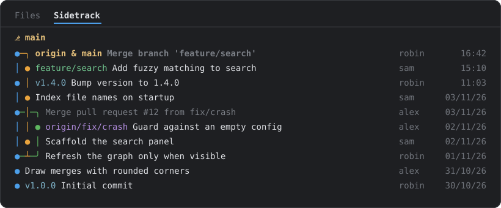

<h1 align="center">sidetrack</h1>

<p align="center">
  <b>Your git history, on the side.</b><br>
  A git graph that lives next to your Claude Code conversation.
</p>

<p align="center">
  
  
</p>

<p align="center">
  
</p>

Claude branches, commits and merges while you talk to it. sidetrack lets you watch that history take shape in a pane beside the conversation, without leaving the session or switching to an IDE.

## Why sidetrack

- **Lanes you can read.** Every branch gets its own color, and forks and merges bend with `╮ ╯ ┬ ┴` right where they happen.
- **Labels at a glance.** The current branch is gold, local branches green, remotes purple and tags teal. A branch and its remote on the same commit share one label: `origin & main`.
- **Always fresh.** The graph refreshes every 3 seconds while its tab is shown, so Claude's commits land as they happen. While hidden it runs nothing.
- **A good neighbour.** It opens as its own tab, never takes the keyboard, opens after filetree so filetree stays the first tab, and hooks nothing Claude does.
- **Fits any width.** Author and date step aside when the pane gets narrow.

## Install

At the prompt of a terminal session:

```text
/plugin install sidetrack --marketplace carminegreen/sidetrack
```

Answer `y` to add the marketplace, then pick a scope.

From a shell:

```bash
claude plugin install sidetrack --marketplace carminegreen/sidetrack
```

In the desktop app, where `/plugin` does not run: click + next to the prompt box, then Plugins, Add marketplace with `carminegreen/sidetrack`, then Add plugin.

## Use

| What | How |
| --- | --- |
| Show or hide the pane | `/sidetrack` |
| Refresh the graph now | click `↻` in the pane's header, or `r` with the pane focused |
| Switch between side panes | click a tab, or `ctrl+x tab` |
| Scroll the history | focus the pane, then the arrow keys |

The pane opens on its own when a session starts. In the terminal it docks on the right in the fullscreen layout (`/tui fullscreen`). A pane opened at start needs a terminal at least 144 columns wide, or 110 once you have opened it by hand.

## What it shows

- The last 250 commits of every branch, remote and tag, newest first
- The HEAD commit in bold, merge commits dimmed
- Author and date on the right, with only the time for today's commits

## Settings

In `/config`, under sidetrack:

```yaml
Open at start:  on | off
```

## Requirements

- Claude Code with mod support
- `git`
- `date`, so Linux or macOS
