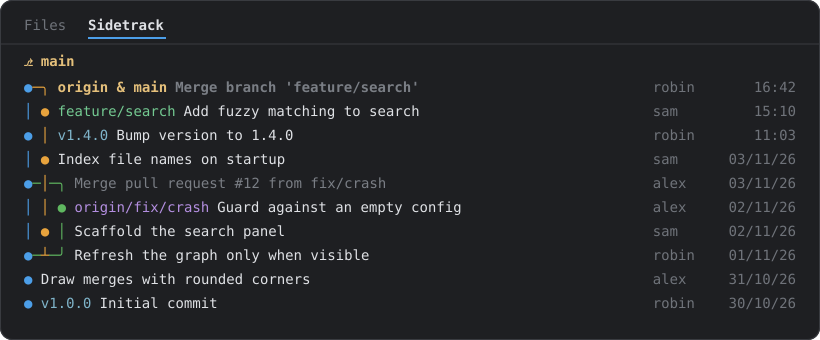

# Git graph

Claude branches, commits and merges while you talk to it. The graph lets you watch that history take shape in a second pane, beside the file tree.

- **Lanes you can read.** Every branch gets its own color, and forks and merges bend with `╮ ╯ ┬ ┴` right where they happen.
- **Labels at a glance.** The current branch is gold, local branches green, remotes purple and tags teal. A branch and its remote on the same commit share one label: `origin & main`.
- **Always fresh.** The graph refreshes every 3 seconds while its tab is shown, so Claude's commits land as they happen. While hidden it runs nothing.
- **A good neighbour.** It opens as its own tab right after the file tree, so the tree stays the first tab, and it never takes the keyboard.
- **Fits any width.** Author and date step aside when the pane gets narrow.

## Use

| What | How |
| --- | --- |
| Show or hide the graph | `/sidetrack` |
| Refresh the graph now | click `↻` in the pane's header, or `r` with the pane focused |
| Switch between the tree and the graph | click a tab, or `ctrl+x tab` |
| Scroll the history | focus the pane, then the arrow keys |

The graph opens on its own when a session starts, with the `Graph at start` setting on. In the terminal it docks on the right in the fullscreen layout (`/tui fullscreen`). A pane opened at start needs a terminal at least 144 columns wide, or 110 once you have opened it by hand.

## What it shows

- The last 250 commits of every branch, remote and tag, newest first
- The HEAD commit in bold, merge commits dimmed
- Author and date on the right, with only the time for today's commits

## Requirements

- `git`
- `date`, so Linux or macOS
