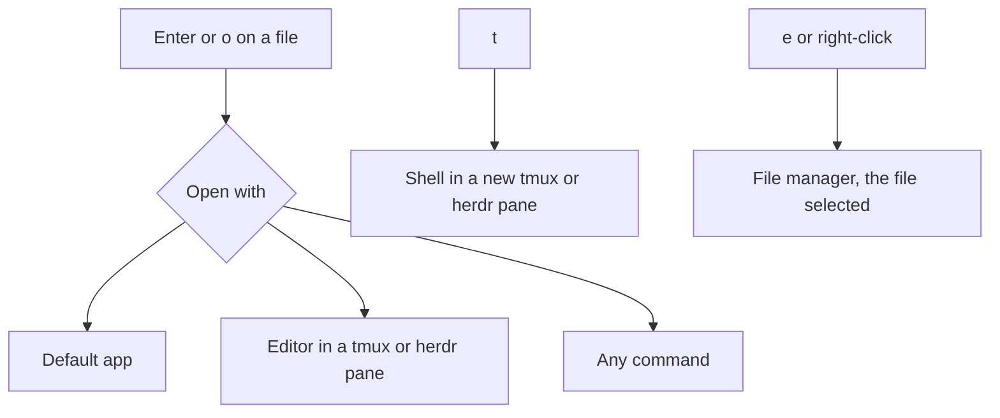

# Open files

- Open files in their default app, an editor in a tmux or herdr pane, or any command, and `t` opens a shell in a folder in a new tmux or herdr pane (where Terminal target says)
- `e`, the right-click menu and the folder button in the preview header show a file in the file manager with the file selected: on Linux through the FileManager1 D-Bus service that Files, Dolphin, Nemo, Caja and Thunar answer, and without one the folder opens in the default app; Finder on macOS; Explorer on Windows. A folder shows selected in its parent

