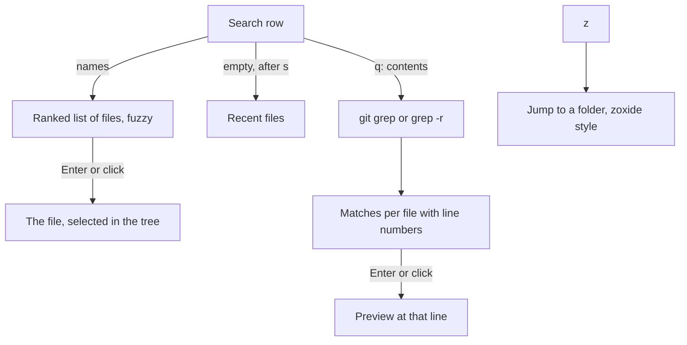

# Search

- The search row says what it searches: `names / text` in the terminal, Names · Text in the Desktop app, and a click or `q` switches; the field reads search file names or search inside files
- Name search lists matching files in place of the tree, best first: the name itself, then names that start with what you typed, contain it, or hold its letters in order (`grts` finds `graph.ts`), then the same on the whole path (`hooks/reg`); the matched letters are highlighted and each file shows its folder. j / k or the arrows pick, Enter or a click goes to the file in the tree with it selected, so it goes to Claude as context, and `e`, `d`, `y`, `t`, `x` act on the picked file
- The `tree` button beside the field shows the matches inside the tree instead, folders opened, as before 0.3.0; `list` goes back
- `s` with an empty field lists the files touched this session, newest first: read, written or committed by Claude, or opened by you, with how long ago
- The contents toggle in the search row (`q` from the tree, or a click on it) searches inside files instead of names, with `git grep` in a repo and `grep -r` outside one; matches are grouped per file with line numbers, the first 200 are shown (fewer in the Desktop app when lines are long), and Enter or a click opens the file in the split preview at that line (the full preview in the Desktop app)
- `s` focuses search, `i` searches in the folder under the cursor, `c` and `r` match case and regular expressions
- `z` jumps to a folder: it opens on the 10 folders you visited most recently, newest first, and once you type it ranks zoxide style: type fragments in order, pick with up and down, and Enter re-roots the tree and moves Claude there with `/cd` where the app has `/cd` (the Desktop app does not); folders that no longer exist drop out of the list; the date column turns into Last accessed and shows when you last went to each folder from the tree, and the column headers do not sort while the list is open; the folder icons in the list turn violet (the terminal's magenta), so the list never reads as the tree, and `jump=#hex` in the Palette setting picks another color
